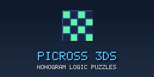
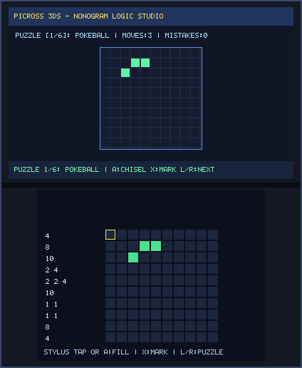
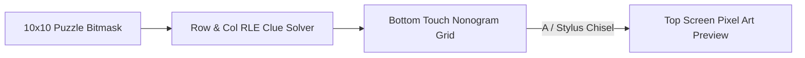

# Picross 3DS (`3ds_picross`)

<p align="center">
  
  &nbsp;&nbsp;&nbsp;
  
</p>

<p align="center">
  
</p>

> **Nonogram Logic Puzzles (`CTR-P-PICR`, UniqueId `0x0D3E8`)** — Part of the [**lafiabrew**](https://github.com/orgs/lafiabrew/repositories) Nintendo 3DS Homebrew Suite.

Stylus-first 10x10 Nonogram/Picross logic puzzle studio with automatic row/column RLE clue calculation, mistake guard, and top-screen pixel-art preview.

---

## Architecture & Data Flow



---

## Controls & Touch Ergonomics

| Button / Input | Action |
|---|---|
| `Stylus Tap` / `A` | Chisel / fill selected cell (auto-marks `X` if empty in solution) |
| `X` | Mark cell with protective `X` cross |
| `D-Pad` | Move grid cursor |
| `L` / `R` | Switch between the 6 built-in Nintendo/Pokémon pixel-art puzzles |

---

## Build, Verify & Install

```bash
make test
make 3ds && make verify-3ds
make qr
```
